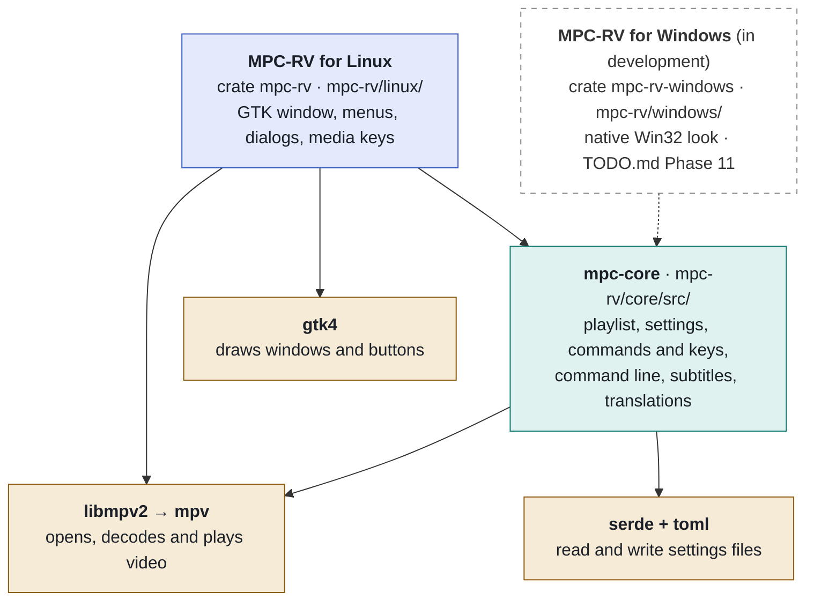
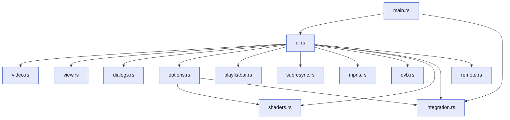
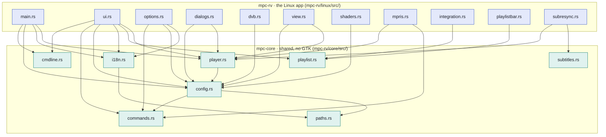

# How the code fits together

A map of MPC-RV's Rust code, written for people who haven't read Rust before. The diagrams are
[Mermaid](https://mermaid.js.org/); GitHub draws them, and so do most editors with a Markdown preview.

## Six Rust words you need

| Word | Meaning |
|---|---|
| **Crate** | A Rust project that builds on its own, like an app or a library. MPC-RV has two: `mpc-rv` (the app you run) and `mpc-core` (shared code). |
| **Cargo.toml** | A crate's settings file: its name, version and the outside libraries it needs ("dependencies"). `Cargo.lock` records the exact versions downloaded. `cargo` is the tool that builds everything. |
| **Workspace** | Several crates built together, sharing one `Cargo.lock` and one `target/` build folder. `mpc-rv/Cargo.toml` sets one up. |
| **Module** | Each `.rs` file is a module: one topic, such as the playlist or the settings. `lib.rs` is the table of contents that lists them. |
| **`use`** | A line like `use crate::config;` means "this file borrows code from `config.rs`". Those lines are the arrows in the diagrams below. |
| **main.rs** | Where the program starts running (its `fn main`). It's kept short and hands over to the rest quickly. |

## The big picture

The code is one repository with a shared core and one app per system (a "monorepo"). The top layer is
what you see: windows, menus, buttons, written separately for Linux and Windows. The bottom layer,
**mpc-core**, holds the rules and data (playlists, settings, key bindings) and knows nothing about
windows, so both apps reuse it.



An arrow means "uses". The arrows only point down: the core never uses an app, GTK or Windows code.
Both layers use mpv: the core starts it and sends it the settings, each app shows its video. The
dashed arrow is the Windows app, which is still being built.

## The folders

```text
mpc-rv/
├── Cargo.toml     the workspace: lists the three crates below (the version number lives here)
├── Cargo.lock     exact library versions
├── core/          shared code (crate mpc-core)
│   ├── src/
│   └── tests/     tests for playlist, settings, commands, command line, subtitles, mpv options
├── linux/         the Linux app (crate mpc-rv, the program mpc-rv)
│   ├── src/
│   └── tests/     tests for discs, desktop entry, keys
├── windows/       the Windows app (crate mpc-rv-windows), in development
│   └── src/
├── res/           icons, logo, translations (po/), video shaders; shared
└── target/        build output, made by cargo, never committed

installers/        one way to install the app per folder: flatpak/, aur/, windows/
```

Each crate folder has its own `Cargo.toml`. Running `cargo build`, `cargo run` or `cargo test` in
`mpc-rv/` covers the core and the Linux app; the Windows app is built on Windows.

Tests live in two places: at the bottom of a file (`mod tests`) for small internal checks, and in the
`tests/` folders for checks from the outside. `cargo test --workspace` runs them all.

## File map

The `lib.rs` files are left out of the diagrams because they only list the other files.

### The Linux app's own files

`main.rs` starts the program and hands over to `ui.rs`, the main window, which uses almost every
other file in the app.



### How the app uses the core

Each app file on top, the core files it uses below. Inside the core, `config.rs` uses `commands.rs`
(for key bindings) and `paths.rs`, `i18n.rs` uses `paths.rs`, and `player.rs` uses `config.rs`.



`video.rs` and `remote.rs` use no core files.

### What each file does

**The Linux app** (`mpc-rv/linux/src/`)

| File | What it does | Outside libraries |
|---|---|---|
| `main.rs` | Where the program starts. Reads the command line, handles the file-association switches, starts mpv (through `player.rs`) and loads the translations, then hands over to `ui.rs`. If MPC-RV is already open, it passes your file to that window instead of opening a second one. | gtk4, libmpv2 |
| `ui.rs` | The main window and nearly everything you click: menu bar, video area, seek bar, toolbar, status bars. Connects every menu item and key to what it does. By far the biggest file. | gtk4, libmpv2, serde_json |
| `video.rs` | The video picture: a GTK drawing area (GLArea) that mpv paints each frame into, through OpenGL. | gtk4, libmpv2 |
| `view.rs` | View › Zoom (resizes the window around the video) and File › Save Thumbnails. | gtk4, libmpv2 |
| `dialogs.rs` | The smaller dialogs: Open Disc/Device, Go To, Properties, Organize Favorites, Save a Copy. | gtk4, libmpv2 |
| `options.rs` | The Options window: a tree of pages on the left, that page's settings on the right. | gtk4 |
| `playlistbar.rs` | The playlist panel beside the video: right-click menu, drag to reorder, Delete to remove, double-click to play. | gtk4 |
| `subresync.rs` | The Subresync bar: shows subtitle lines with their times and lets you shift them until they match the speech. | gtk4, libmpv2 |
| `mpris.rs` | Talks to the desktop over D-Bus (MPRIS), so media keys, GNOME's media controls and `playerctl` can control the player. | gtk4, libmpv2 |
| `dvb.rs` | Digital TV: reads the channel list (`channels.conf`) and runs the tuner scan. | gtk4 |
| `shaders.rs` | Video shaders (sharpen, grayscale, ...) and the shader editor. The shader files are in `res/shaders/`. | gtk4 |
| `integration.rs` | Desktop integration: the applications-menu entry, which file types open with MPC-RV, and the shut down / sleep actions after playback. | gtk4 |
| `remote.rs` | A control socket other programs can send JSON commands to. Replaces MPC-HC's Windows-only remote control API. | serde_json |

**The shared core** (`mpc-rv/core/src/`)

| File | What it does | Outside libraries |
|---|---|---|
| `cmdline.rs` | Understands command-line switches like `/fullscreen`, `/play` or `/new`, and tells them apart from file paths. | none |
| `commands.rs` | The list of all player commands, copied from MPC-HC, each with its default key, mouse action and media key; also applies your own key changes. | serde |
| `config.rs` | Every setting and its default. Reads and saves `config.toml`, `history.toml` (recent files, positions) and the last playlist. | serde, toml |
| `i18n.rs` | Translations into 42 languages, using MPC-HC's own translation files from `res/po/`. | none |
| `playlist.rs` | The playlist itself: items, shuffle and repeat, playlist files (`.mpcpl`, `.m3u`, `.pls`, `.asx`, `.cue`), next file in a folder. | none |
| `subtitles.rs` | Reads and writes subtitle timings (SRT, WebVTT, ASS) for the Subresync bar. mpv does the actual subtitle drawing. | none |
| `paths.rs` | Finds your folders: settings (`~/.config`), Pictures, system data. Replaces GTK's version so the core needs no GTK. | none |
| `player.rs` | Talks to mpv: starts it with MPC's defaults, turns the settings (audio, subtitles, video, Video Frame, Pan & Scan) into mpv options, and has the small helpers every file uses to read and set mpv properties. | libmpv2 |

**The Windows app** (`mpc-rv/windows/src/`, in development)

| File | What it does | Outside libraries |
|---|---|---|
| `main.rs` | For now: reads the command line and the settings, starts mpv (through `player.rs`) and plays the files in mpv's own window. The native Win32 window replaces that in TODO.md Phase 11.2. | libmpv2 |

## What happens when you open a movie

Running `mpc-rv movie.mp4`, in order:

1. **`main.rs` + `cmdline.rs`:** the command line is read: file names and switches such as
   `/fullscreen`. File-association switches like `/regvid` are handled right here, by `integration.rs`.
2. **`main.rs` + `player.rs`:** mpv is started with MPC's defaults (stay on the last frame, volume
   limits, subtitle folders). It lives until the program closes.
3. **`config.rs` + `i18n.rs`:** settings are loaded from `~/.config/mpc-rv/config.toml`, and the
   menus' language is picked.
4. **`main.rs` + GTK:** GTK starts the app. If MPC-RV is already open, the file is sent to that window
   and this copy quits.
5. **`ui.rs`:** the main window is built: menus and keys from the command table (`commands.rs`), the
   video area (`video.rs`), the playlist panel (`playlistbar.rs`), media keys (`mpris.rs`) and the
   control socket (`remote.rs`).
6. **`playlist.rs` → `ui.rs` → mpv:** the file goes into the playlist and mpv is told to load it. mpv
   decodes it, and `video.rs` paints each frame into the window.
7. **`config.rs`:** while you watch and when you quit, recent files and positions go to
   `history.toml` and the playlist to `default.mpcpl`.

## Where do I change...

| What | File |
|---|---|
| A default keyboard shortcut or mouse action | `mpc-rv/core/src/commands.rs` |
| A setting's default value | `mpc-rv/core/src/config.rs` |
| How a setting is passed to mpv | `mpc-rv/core/src/player.rs` |
| A menu item, or what a command does | `mpc-rv/linux/src/ui.rs` |
| A page in the Options window | `mpc-rv/linux/src/options.rs` |
| Playlist file formats (`.m3u`, `.pls`, ...) | `mpc-rv/core/src/playlist.rs` |
| A translation | `mpc-rv/res/po/*.po` |
| The icon or idle-screen logo | `mpc-rv/res/make_art.py` |
| The version number or a library | `mpc-rv/Cargo.toml` |

Most features start in a menu in `ui.rs` and then call into one of the smaller files.
